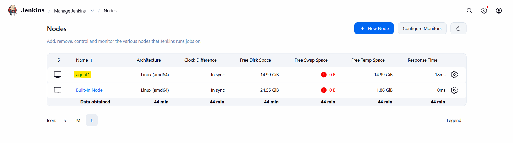
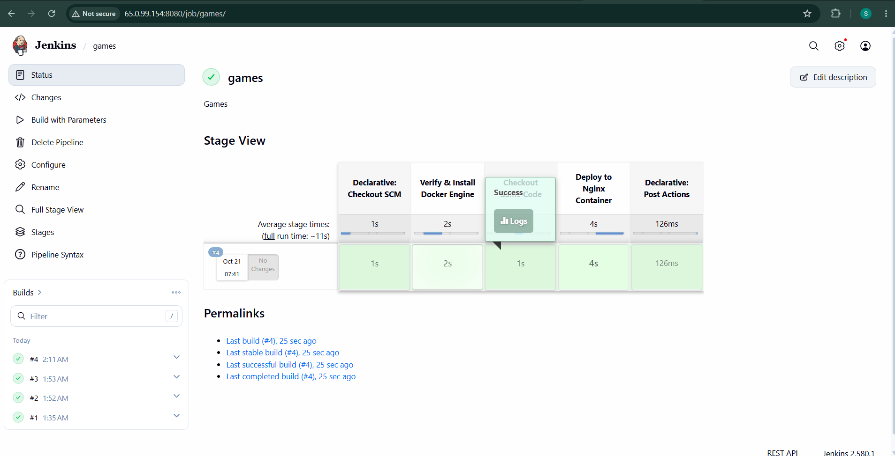
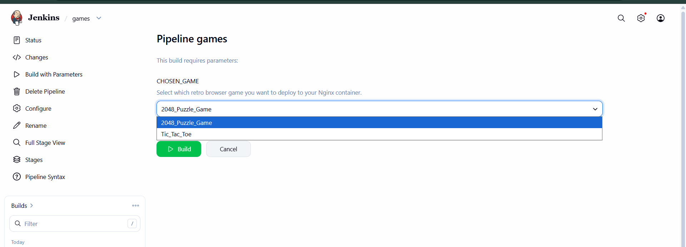
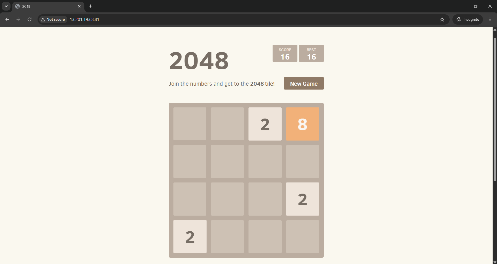
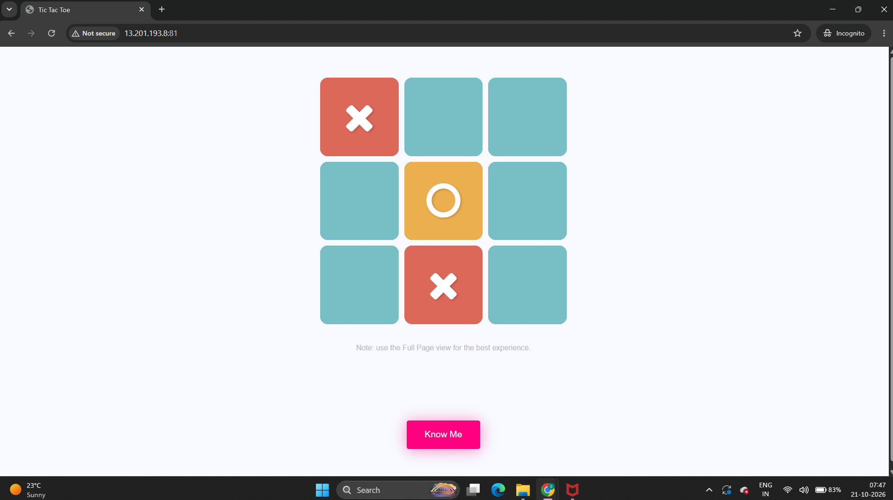

# Project Proof of Concept (POC) Documentation

This document outlines the Jenkins pipeline configuration, build execution, and final game outcomes captured during the validation phase.

## 1. Jenkins SSH Agent Setup
To establish secure communication between the master node and the execution environment, we generated an SSH key pair. The target server was configured with the public key, enabling passwordless authentication.

## 2. Jenkins Pipeline Orchestration
The deployment process is managed using a declarative Jenkins pipeline. This interface provides visual feedback on each sequential phase of the build, from pulling code to final compilation.

## 3. Parameterized Build Settings
To increase deployment flexibility, we implemented parameterized triggers. This allows the engineering team to manually toggle specific environment variables and options right before launching a build execution.

## 4. Game Validation: Round One
Following successful deployment, functional testing was carried out. The screenshot below confirms the initial interactive outcome and user interface responsiveness during the first round of simulation.

## 5. Game Validation: Round Two
A second test case was executed to verify state persistence and error handling. The resulting system layout confirms that the application behaves deterministically under standard conditions.

